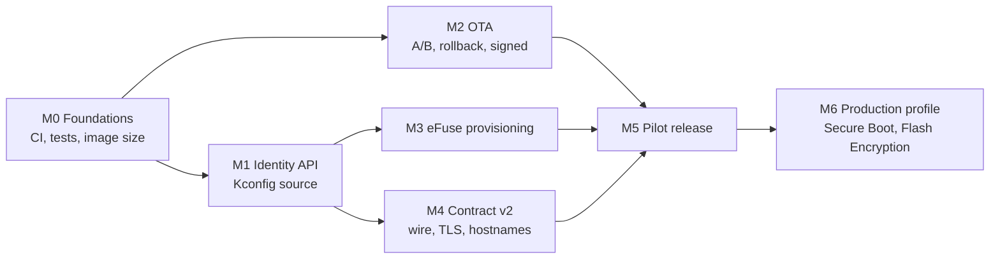

# Firmware Implementation Plan — Identity, Contract v2 and OTA

**Implements:** `ROBOT_IDENTITY_AND_KEYS.md` (the design; section and decision
numbers below refer to it). Plain-language version:
`WHY_FIRMWARE_IDENTITY_MATTERS.md`.
**Target:** ESP32-S3 (WROOM-1 N16R8), ESP-IDF **v5.5.4**, products MPX and MP4.
**Status:** plan only. The one change already made is the robot token on
marketplace calls (`main/network/marketplace_proxy.cc`).

---

## Executive summary

Seven milestones take the firmware from "one public key for every robot, no
updates" to "unique chip-bound identity, frozen robot↔cloud contract, safe OTA,
locked-down production units". Everything up to and including M5 must be done
before the first pilot unit ships; M6 before the first Kickstarter unit.

| Milestone | Rough effort | Design phase | Gate |
|---|---|---|---|
| M0 Foundations | 1 week | A | flash layout decided |
| M1 Identity API (Kconfig source) | 1 week | A | all call sites switched, no behaviour change |
| M2 OTA | 2–3 weeks | P | tests 18–22 pass |
| M3 eFuse provisioning | 1.5 weeks | B | tests 5a–10c on sacrificial boards |
| M4 Contract v2 | 3 weeks | P | golden vectors match the gateways (test 14) |
| M5 Pilot release | 1 week + ≥ 4-week soak | P, soak | D18 exit criteria |
| M6 Production profile | 1 week + factory trial | C | tests 10–12, 17 |

M2, M3 and M4 can run in parallel after M1 (M2 only needs M0). With two
firmware engineers, first pilot unit ≈ 7–8 weeks from start.

**Biggest risks:** the flash layout (A/B OTA doesn't fit today, M0), TLS memory
on a socket- and RAM-constrained device (M4), and irreversible eFuse burns
(M3, M6: sacrificial boards only until the procedure is proven).

---

## Current state (verified in code, 2026-10-26)

| Area | Today | Where |
|---|---|---|
| Robot ID / key | Kconfig strings, `MPX-DOG-01` / `…0001`, shared by every unit | `main/Kconfig.projbuild:174-193` |
| `APP_MPX_EFUSE_BLK` | option exists, does nothing; its help text is wrong for ESP32-S3 | `main/Kconfig.projbuild:214-232` |
| ID / key users | `chat_ws.cc:49`, `:592`, `:626-629`; `wasm_decrypt.cc:48`, `:118`; `agent_config.cc:216-236`; `http_server.cc:2504`, `:2614`; `pi_link.cc:65-66`, `:189` | |
| Boot order | `init_nvs` → robot → screen → audio → Pi link → LittleFS → Wi-Fi → PWA → HTTP → chat → WASM → Lua → agent → voice | `main/main.cc:70-191` |
| Boot fragility | LittleFS mount failure, PWA deploy failure, HTTP or WASM init failure **return from `app_main`**, ending boot | `main/main.cc:115-164` |
| OTA | none: single 7 MB `factory` slot, no `otadata`, rollback off | `partitions.csv`, `sdkconfig:422` |
| Transport | plain `ws://` and `http://` to a raw IP (`35.220.215.160`); the marketplace proxy is hand-written HTTP over raw sockets | `Kconfig.projbuild:126`, `:506`, `:557`; `marketplace_proxy.cc` |
| Battery | no usable level or charging signal ("were it ever reported") | `robot/robot.h:530` |
| Tests / CI | none in the repo; `tools/` has only `check_comments.py` and `pi/` | |
| `sdkconfig` | tracked in git despite `.gitignore` | design §1.1 |

---

## M0 — Foundations

**Goal:** make every later milestone measurable and repeatable.

| Task | Detail |
|---|---|
| Reproducible build | Pin ESP-IDF v5.5.4 (the container in `.devcontainer`, or a documented install). Document the Windows gotchas: run with `PYTHONUTF8=1`, otherwise `idf.py` crashes on a GBK console. |
| CI | Build on every push: `idf.py build`, `idf.py size`, fail if the app exceeds the planned OTA slot size minus a 10% margin. Host tests (below). Run `tools/check_comments.py`. |
| Host tests | New pure-logic component(s) build for the ESP-IDF `linux` target with Unity, so identity, ID checks, key derivation and frame code run in CI without hardware. |
| Golden vectors | `tools/vectors/` with a Python generator shared with the cloud repo; firmware host tests and the gateway both check against the same files (test 14). |
| `sdkconfig` | `git rm --cached sdkconfig`; move project settings into `sdkconfig.defaults` (+ `sdkconfig.defaults.prod` in M6). |
| Version | `PROJECT_VER` from the release tag (`CONFIG_APP_PROJECT_VER_FROM_CONFIG` set by CI); `project_name` per product (MPX / MP4) for the OTA product guard. |
| **Measure** | Release image size (`idf.py size`), and bootloader size with Secure Boot v2 + Flash Encryption enabled (does the partition table have to move from `0x8000`? §13 #7). |
| **Decide the layout** | With the numbers: 32 MB flash vs. shrinking the image vs. shrinking `storage` (D20, §13 #16). Write the new `partitions.csv`. This is the one-way door (§12.1 #8) that blocks M2. |

**Done when:** CI is green on `main`, the image size is a tracked number, and
the flash layout is signed off by firmware and hardware leads.

## M1 — Identity API (Kconfig source only)

**Goal:** every consumer of the robot ID and key goes through one API, with no
behaviour change yet. Design §8.1.

| Task | Detail |
|---|---|
| New component | `components/mpx_identity/` (rather than `main/identity/`, so it builds for host tests): `mpx_identity.h` API from §8.1 (`init`, `state`, `robot_id`, `robot_key`, `key_version`, `key_fp`, `sec_flags`). |
| Kconfig | `choice APP_IDENTITY_SOURCE` (KCONFIG / EFUSE); `APP_ROBOT_UUID` and `APP_CHAT_AES_KEY_HEX` depend on KCONFIG; delete `APP_MPX_EFUSE_BLK`. |
| ID checks | §6.1 format + check symbol, legacy short IDs allowed in KCONFIG mode; exactly-16-byte frame field (`memcpy`, no silent `strncpy` truncation). |
| Switch call sites | `chat_ws.cc:49`, `:592`, `:626-629`, `:1453`; `wasm_decrypt.cc:48`, `:118`; `agent_config.cc:216-236` (and so `marketplace_proxy.cc`); `http_server.cc:2504`, `:2614`; `pi_link.cc:65-66`, `:189`. |
| Boot | `mpx_identity_init()` right after `init_nvs()` (`main.cc:72`). |
| Unprovisioned mode | Motion, PWA and Lua work; cloud chat, robot token and MPXE are off with a clear log line and a PWA status field. |
| Dev safety | Log an error at boot when the key is the public `…0001`. |
| Dev tool | `tools/mpx_dev_identity.py`: unique `DEV-…` ID + random key into a local, untracked `sdkconfig` override (D11). |

**Done when:** host tests cover ID validation and token/key handling; a dev
robot behaves exactly as before; `rg CONFIG_APP_ROBOT_UUID main` finds only the
identity component.

## M2 — OTA (D20)

**Goal:** every unit can be updated safely for life. Depends only on M0's
layout decision, so it can start in parallel with M1.

| Task | Detail |
|---|---|
| Partitions | New `partitions.csv`: `otadata`, `ota_0`, `ota_1` (size from M0), `nvs` kept at `0x9000`, `model`, `system`, `storage`. |
| Bootloader config | `CONFIG_BOOTLOADER_APP_ROLLBACK_ENABLE=y`; anti-rollback built in (`CONFIG_BOOTLOADER_APP_ANTI_ROLLBACK`), effective only once the `SECURE_VERSION` eFuse is used on secure units. |
| Signed images | Pilot profile: `CONFIG_SECURE_SIGNED_APPS_NO_SECURE_BOOT` + `CONFIG_SECURE_SIGNED_ON_UPDATE_NO_SECURE_BOOT`. Release signing key kept offline / in KMS; CI signs, developers can't. Test that a dev-built unsigned image is refused by OTA but still flashable over USB on pilot units. |
| OTA client | `main/ota/`: poll `GET /v1/ota/check` (robot token auth) on boot + every few hours; `esp_https_ota` with the CA bundle; read `esp_app_desc_t` via `esp_https_ota_get_img_desc` and refuse a wrong `project_name`, layout version or lower version; verify SHA-256 from the manifest. |
| Install policy | Download in the background; install only when idle (no gait, skill, Lua or Pi control active). **Battery/charging gate needs a hardware signal that doesn't exist today** — track with the hardware team; until then: idle + owner confirmation in the PWA. |
| Health check | After an update: identity loads, LittleFS mounts, servos/IMU init, and (if the robot was online before) gateway connection + a successful OTA check within ~5 min → `esp_ota_mark_app_valid_cancel_rollback()`. Otherwise reboot → rollback, and report the failure on the next check. |
| Boot fragility | Make the `return`s in `main.cc:115-164` non-fatal where possible, so a data-partition problem can't strand a unit with no OTA. The OTA client must start even if LittleFS, the PWA or WASM fail. |
| Data partitions | Version marker in `system` and `model`; after the app is marked valid, fetch a new data image if the manifest lists one, write it, verify SHA-256, retry on failure. |
| PWA / API | `/v1/ota/status` (current version, available version, state), "Install now" action, progress. |
| Cloud dependency | `/v1/ota/check`, release manifests, cohort rollout (D20). Firmware can develop against a static manifest file first. |

**Done when:** tests 18–22 pass on a pilot-profile board, including power cuts
at every stage, and an image has been pushed to an office unit end to end.

## M3 — eFuse provisioning (design phase B)

**Goal:** a unit can be given its permanent identity on the bench/factory
station. **Sacrificial boards only** until every test passes.

| Task | Detail |
|---|---|
| eFuse table | `main/esp_efuse_custom_table.csv` per §6.2 (`USR_DATA`: ID, format byte, flags, `kv_base`); `CONFIG_EFUSE_CUSTOM_TABLE=y`. |
| EFUSE source | `mpx_identity` reads the record, finds the `HMAC_UP` block by purpose, derives `K` once with `esp_hmac_calculate` (§6.3 vectors). |
| Provisioning listener | `@MPXPROV` serial protocol (§6.6) in the identity component: runs only when unprovisioned/inconsistent/not yet activated, and **before Wi-Fi** with `bootloader_random_enable()` (D9). |
| Burn sequence | Order from §7: `HMAC_UP` secret → DS key (RSA-3072, `esp_ds_encrypt_params`, D17) → `USR_DATA` + write-protect → derive `K1` → seal with RSA-OAEP to the embedded `prov_seal_pub.pem` (§6.4) → zero all secrets. |
| Resume paths | Power loss after each burn (§9): `status` reports `INCONSISTENT`, `reseal` works with the same nonce. |
| Station tool | `tools/mpx_provision.py`: reserve, provision, upload, compare `key_fp`, `lock` (no-op on pilot), `--replace` for board replacement (D15). |
| Replacement | `kv_base` handling and the `kv` hint (D13, D15). |

**Done when:** tests 5a–9 and 10b–10c pass on sacrificial boards; the RSA key
generation time is recorded (§13 #9).

## M4 — Contract v2 (design phase P, §6.9)

**Goal:** the robot↔cloud contract the pilot units will speak for life.
Written down first in `docs/WIRE_PROTOCOL_V2.md`, reviewed with the cloud side.

| Item | Firmware work |
|---|---|
| C3 frame header | Protocol version + key version bytes, both in the GCM AAD (`chat_ws.cc`). |
| C4 subkeys | HKDF from `K_v` for chat-up, chat-down, MPXE wrap, robot token; `K_v` never used directly (`chat_ws.cc`, `wasm_decrypt.cc`, `agent_config.cc`). |
| C5 replay | Check the downstream counter in the AAD; reject repeats. |
| C6 MPXE v2 | AAD adds skill version and `not_after` (`wasm_decrypt.cc`). |
| C7 control messages | `key_rotate`, `kv_mismatch`, skill re-sync, DS challenge/response: implemented and tested even if the cloud doesn't send them yet. |
| C8 endpoints + TLS | Final hostnames (`robot.<domain>`, `provision.<domain>`), TLS verified against the ESP-IDF CA bundle for chat (`wss://`), voice, LLM and marketplace. Replace the raw-socket HTTP in `marketplace_proxy.cc` with `esp_http_client`. **Measure internal RAM and the 16-socket LWIP pool with TLS on**; keep mbedTLS buffers in PSRAM where possible. |
| C9 voice identity | Voice `Device-Id` = robot ID instead of the MAC (`mpx_voice_ota.c:102-110`). |
| C10 OTA | From M2. |

**Done when:** golden vectors for every item match byte for byte between the
firmware host tests and the Python gateway (test 14); the production gateway
refuses v1 (test 15); heap and socket headroom with TLS are measured and
acceptable.

## M5 — Pilot release

| Task | Detail |
|---|---|
| Release build | Pilot profile (eFuse identity, signed apps, no Secure Boot / Flash Encryption), signed by CI. |
| Bench provisioning | Office station with the pilot station token; units sealed as `cohort='pilot'`. |
| USB recovery | Written procedure for pilot owners (§13 #15). |
| Soak | ≥ 4 weeks: at least one OTA reaches every unit; one board replacement end to end; no §6.9 change (D18 exit criteria). |

## M6 — Production profile (design phase C)

| Task | Detail |
|---|---|
| `sdkconfig.defaults.prod` | eFuse identity, Secure Boot v2 with `ALLOW_EFUSE_RD_DIS`, Flash Encryption release mode, anti-rollback on, secure download mode, JTAG off (§8.1, §12.1 part 2). |
| Build guards | `#error` guards from §8.1 so a secure build can't use the Kconfig identity. |
| Lock step | `lock` burns `WR_DIS_RD_DIS` and finishes Flash Encryption release mode (§7). |
| Pilot upgrade | Pilot unit → Secure Boot + Flash Encryption over USB → `lock` → reseal (test 17), on a sacrificial pilot board first. |
| Factory trial | Station runbook, timing per unit, reconciliation log. |

**Done when:** tests 10–12 and 17 pass; a factory trial batch is provisioned
and reconciled against the cloud.

---

## Dependencies on other teams

| Needed from | What | Needed by |
|---|---|---|
| Hardware | Flash size decision (16 vs 32 MB); a battery level / charging signal | M0; M2 |
| Cloud | Prod registry + key ring, `/v1/provision/*`, `/v1/ota/check`, release storage, v2 gateway, final DNS + TLS | M3, M2, M4 |
| Security / ops | Release signing key and where it lives; Secure Boot key ceremony | M2, M6 |

## Rules while implementing

- **Never burn eFuses on a board you can't afford to lose** until the
  procedure has passed on sacrificial boards.
- **Every contract item gets golden vectors before it ships.** A vector change
  after the freeze is a contract change.
- **A unit must always be able to reach OTA**, whatever else fails at boot.
- **One image per product.** No per-unit builds; identity lives in eFuse.
