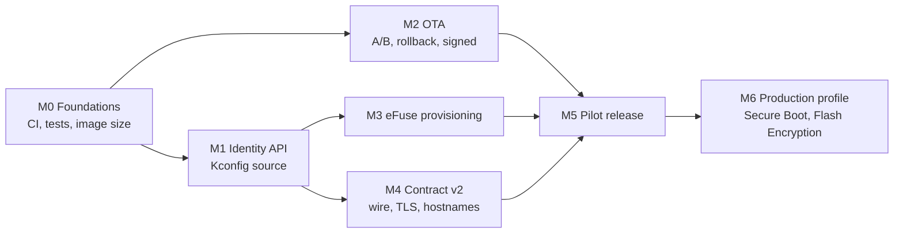

# Firmware Implementation Plan — Identity, Contract v2 and OTA

**Implements:** `ROBOT_IDENTITY_AND_KEYS.md` (the design; section and decision
numbers below refer to it). Plain-language version:
`WHY_FIRMWARE_IDENTITY_MATTERS.md`.
**Target:** ESP32-S3 (WROOM-1 N16R8), ESP-IDF **v5.5.4**, products MPX and MP4.
**Status:** plan only. The one change already made is the robot token on
marketplace calls (`main/network/marketplace_proxy.cc`).

---

## Executive summary

Seven milestones take the firmware from "one public key for every robot, no
updates" to "unique chip-bound identity, frozen robot↔cloud contract, safe OTA,
locked-down production units". Everything up to and including M5 must be done
before the first pilot unit ships; M6 before the first Kickstarter unit.

| Milestone | Rough effort | Design phase | Gate |
|---|---|---|---|
| M0 Foundations | 1 week | A | flash layout decided |
| M1 Identity API (Kconfig source) | 1 week | A | all call sites switched, no behaviour change |
| M2 OTA | 2–3 weeks | P | tests 18–22 pass |
| M3 eFuse provisioning | 1.5 weeks | B | tests 5a–10c on sacrificial boards |
| M4 Contract v2 | 3 weeks | P | golden vectors match the gateways (test 14) |
| M5 Pilot release | 1 week + ≥ 4-week soak | P, soak | D18 exit criteria |
| M6 Production profile | 1 week + factory trial | C | tests 10–12, 17 |

M2, M3 and M4 can run in parallel after M1 (M2 only needs M0). With two
firmware engineers, first pilot unit ≈ 7–8 weeks from start.

**Biggest risks:** the flash layout (A/B OTA doesn't fit today, M0), TLS memory
on a socket- and RAM-constrained device (M4), and irreversible eFuse burns
(M3, M6: sacrificial boards only until the procedure is proven).

---

## Current state (verified in code, 2026-10-26)

| Area | Today | Where |
|---|---|---|
| Robot ID / key | Kconfig strings, `MPX-DOG-01` / `…0001`, shared by every unit | `main/Kconfig.projbuild:174-193` |
| `APP_MPX_EFUSE_BLK` | option exists, does nothing; its help text is wrong for ESP32-S3 | `main/Kconfig.projbuild:214-232` |
| ID / key users | `chat_ws.cc:49`, `:592`, `:626-629`; `wasm_decrypt.cc:48`, `:118`; `agent_config.cc:216-236`; `http_server.cc:2504`, `:2614`; `pi_link.cc:65-66`, `:189` | |
| Boot order | `init_nvs` → robot → screen → audio → Pi link → LittleFS → Wi-Fi → PWA → HTTP → chat → WASM → Lua → agent → voice | `main/main.cc:70-191` |
| Boot fragility | LittleFS mount failure, PWA deploy failure, HTTP or WASM init failure **return from `app_main`**, ending boot | `main/main.cc:115-164` |
| OTA | none: single 7 MB `factory` slot, no `otadata`, rollback off | `partitions.csv`, `sdkconfig:422` |
| Transport | plain `ws://` and `http://` to a raw IP (`35.220.215.160`); the marketplace proxy is hand-written HTTP over raw sockets | `Kconfig.projbuild:126`, `:506`, `:557`; `marketplace_proxy.cc` |
| Battery | no usable level or charging signal ("were it ever reported") | `robot/robot.h:530` |
| Tests / CI | none in the repo; `tools/` has only `check_comments.py` and `pi/` | |
| `sdkconfig` | tracked in git despite `.gitignore` | design §1.1 |

---

## M0 — Foundations

**Goal:** make every later milestone measurable and repeatable.

| Task | Detail |
|---|---|
| Reproducible build | Pin ESP-IDF v5.5.4 (the container in `.devcontainer`, or a documented install). Document the Windows gotchas: run with `PYTHONUTF8=1`, otherwise `idf.py` crashes on a GBK console. |
| CI | Build on every push: `idf.py build`, `idf.py size`, fail if the app exceeds the planned OTA slot size minus a 10% margin. Host tests (below). Run `tools/check_comments.py`. |
| Host tests | New pure-logic component(s) build for the ESP-IDF `linux` target with Unity, so identity, ID checks, key derivation and frame code run in CI without hardware. |
| Golden vectors | `tools/vectors/` with a Python generator shared with the cloud repo; firmware host tests and the gateway both check against the same files (test 14). |
| `sdkconfig` | `git rm --cached sdkconfig`; move project settings into `sdkconfig.defaults` (+ `sdkconfig.defaults.prod` in M6). |
| Version | `PROJECT_VER` from the release tag (`CONFIG_APP_PROJECT_VER_FROM_CONFIG` set by CI); `project_name` per product (MPX / MP4) for the OTA product guard. |
| **Measure** | Release image size (`idf.py size`), and bootloader size with Secure Boot v2 + Flash Encryption enabled (does the partition table have to move from `0x8000`? §13 #7). |
| **Decide the layout** | With the numbers: 32 MB flash vs. shrinking the image vs. shrinking `storage` (D20, §13 #16). Write the new `partitions.csv`. This is the one-way door (§12.1 #8) that blocks M2. |

**Done when:** CI is green on `main`, the image size is a tracked number, and
the flash layout is signed off by firmware and hardware leads.

### M0 as built

The table above was the plan. This is what shipped, and what changed.

| Task | As built |
|---|---|
| CI | `.github/workflows/ci.yml`, three jobs: `host-tests` (cmake + ctest, fails fast), `pwa` (builds `pwa-claw/www`, which `main/CMakeLists.txt` needs at configure time and which is gitignored), `firmware` (`espressif/esp-idf-ci-action@v1`, IDF v5.5.4, `idf.py -DIDF_TARGET=esp32s3 -DMPX_BUILD_PWA=OFF build`). The target must be passed explicitly now that `sdkconfig` is untracked. Two gaps, both deliberate: the size gate needs the OTA slot size (the flash-layout decision that is still open), so CI records `build/MPX-Dog.bin` as an artifact instead of asserting a guessed threshold; and `tools/check_comments.py` is not wired in yet. |
| Host tests | **Deviation:** not the ESP-IDF `linux` target with Unity. `set-target linux` drags in the whole component graph and esp-sr, LVGL and WAMR do not build for it, so the logic under test would never be reachable. Instead `tools/host_tests/` is a standalone CMake project with a small zero-dependency harness (`test_harness.h`): no ESP-IDF, no board, no network. The forcing constraint lands on the code under test, not the runner — `mpx_id.c` and `mpx_derive.c` must be free of ESP headers, taking `S` plus an `hmac_sha256` callback, with `mpx_identity.cc` supplying `esp_hmac_calculate` on device and the tests supplying `mbedtls_md_hmac`. Tests are picked up by a `CONFIGURE_DEPENDS` glob. Local shortcut: `idf.py host-test`. |
| Golden vectors | `tools/mpx_id.py` (the Python reference implementation: `new`, `check`, `derive`, `vectors`, `c-header`, `selftest`) and the generated `tools/vectors/identity.json`. `vectors --check` fails CI when the file is stale, and `c-header` emits `mpx_vectors.h` at build time so the C tests need no JSON parser. `selftest` covers §11 test 1 plus the §6.3 vectors. |
| `sdkconfig` | Done: `git rm --cached`, and `.gitignore` now records why. `sdkconfig.defaults` already carried the custom partition table and the 16 MB flash size, so CI can configure from the defaults alone. |

**Still open in M0:** the image-size measurement and the flash-layout decision
(§13 #16). Both need hardware numbers, and the layout is the one-way door that
blocks M2 (OTA), not M1 (identity).

**Parity verified.** With `sdkconfig` deleted entirely, `idf.py reconfigure`
builds a configuration from `sdkconfig.defaults` alone that differs from the
last committed `sdkconfig` in exactly two symbols: `APP_RL_GUARD_TEMP_DC`
(600 in the defaults, `1500` — the "off" value — in one dev's local file) and
`APP_IMU_LOG_ENABLE` (`y` in the defaults, off locally). Both are local
`menuconfig` tweaks, i.e. precisely the drift untracking removes. Neither was
back-ported: 600 is the shipped 60 °C backstop and 1500 disables it. The two
consequences are that a developer who had the guard off must keep setting it in
their own `sdkconfig`, and that CI now logs IMU data.

## M1 — Identity API (Kconfig source only)

**Goal:** every consumer of the robot ID and key goes through one API, with no
behaviour change yet. Design §8.1.

| Task | Detail |
|---|---|
| New component | `components/mpx_identity/` (rather than `main/identity/`, so it builds for host tests): `mpx_identity.h` API from §8.1 (`init`, `state`, `robot_id`, `robot_key`, `key_version`, `key_fp`, `sec_flags`). |
| Kconfig | `choice APP_IDENTITY_SOURCE` (KCONFIG / EFUSE); `APP_ROBOT_UUID` and `APP_CHAT_AES_KEY_HEX` depend on KCONFIG; delete `APP_MPX_EFUSE_BLK`. |
| ID checks | §6.1 format + check symbol, legacy short IDs allowed in KCONFIG mode; exactly-16-byte frame field (`memcpy`, no silent `strncpy` truncation). |
| Switch call sites | `chat_ws.cc:49`, `:592`, `:626-629`, `:1453`; `wasm_decrypt.cc:48`, `:118`; `agent_config.cc:216-236` (and so `marketplace_proxy.cc`); `http_server.cc:2504`, `:2614`; `pi_link.cc:65-66`, `:189`. |
| Boot | `mpx_identity_init()` right after `init_nvs()` (`main.cc:72`). |
| Unprovisioned mode | Motion, PWA and Lua work; cloud chat, robot token and MPXE are off with a clear log line and a PWA status field. |
| Dev safety | Log an error at boot when the key is the public `…0001`. |
| Dev tool | `tools/mpx_dev_identity.py`: unique `DEV-…` ID + random key into a local, untracked `sdkconfig` override (D11). |

**Done when:** host tests cover ID validation and token/key handling; a dev
robot behaves exactly as before; `rg CONFIG_APP_ROBOT_UUID main` finds only the
identity component.

### M1 as built

M1 is done. The API is the one §8.1 specifies, with one addition and one
subtraction.

| Piece | Where |
|---|---|
| ESP-free ID format (§6.1) | `components/mpx_identity/mpx_id.c` — Luhn-32 with the `a/32 + a%32` fold, `mpx_id_to_frame()` zero-pads and refuses to truncate |
| ESP-free derivation (§6.3) | `components/mpx_identity/mpx_derive.c` — takes an `mpx_hmac_sha256_fn` callback instead of linking mbedTLS, which is what lets the host tests run the real derivation |
| Adapter | `components/mpx_identity/mpx_identity.cc` — Kconfig parsing, NVS `kv` override, `mpx_identity_state()`, the `SECURE_BOOT` guard |
| Kconfig | `choice APP_IDENTITY_SOURCE` above `APP_ROBOT_UUID`; both credential symbols now `depends on APP_IDENTITY_SOURCE_KCONFIG`; `APP_MPX_EFUSE_BLK` deleted (it was a no-op with help text that described something else) |
| Call sites | all six files switched; `rg CONFIG_APP_ROBOT_UUID main` and `rg CONFIG_APP_CHAT_AES_KEY_HEX main` are both empty |
| Dev identity | `tools/mpx_dev_identity.py show \| apply` — unique `DEV-` ID + random key into the untracked `sdkconfig` (D11), refusing to overwrite a real identity without `--force` |
| PWA signal | `/v1/gateway/config` now returns `identity_state` and `key_fp` |

**Added:** `mpx_identity_key_version()` (NVS key `kv`, fallen back to 1). It is
not in §8.1, but Stage 3 puts the key version into the frame AAD, and having the
accessor now means `chat_ws.cc` is touched once instead of twice.

**Subtracted:** the `NDEBUG`-only all-zero-key refusal that used to live in
`wasm_decrypt.cc`. Refusing an unprovisioned key belongs in the identity, and
putting it there means it also covers `chat_ws` and the robot token instead of
the one caller that happened to think of it.

**`CONFIG_APP_IDENTITY_SOURCE_EFUSE` does not work yet, on purpose.**
`load_efuse_identity()` returns `ESP_ERR_NOT_SUPPORTED` and says so in the log.
An eFuse reader that silently reads zeros would be worse than no reader: it
would produce a plausible-looking key and a robot that fails to authenticate
with no clue why. That code arrives with the sealing station in Stage 2.

**Host test coverage:** 19 assertions-worth of cases in
`tools/host_tests/tests/test_identity.c` — the golden IDs, the golden bad IDs,
`NULL`/short/long, the check symbol, every single-symbol substitution (3 × 12 ×
31 variants), frame padding, legacy `MPX-DOG-01`, `DEV-` prefix, the 37-byte
message against the vectors, and — when OpenSSL is present — the derived key and
fingerprint against the frozen `§6.3` values. OpenSSL is optional because the
callback is injected; without it the message layout is still checked.

**Bug the tests found, worth knowing before Stage 2:**
`tools/vectors/identity.json` shipped `MPX-ZZZZZZZZZZZZ` as a valid ID, whose
check symbol did not match its own body (`MPX-ZZZZZZZZZZZB` does). Nothing
asserted that the vectors were valid — `python_selftest` only checked generated
IDs — so the C tests failed on a vector file bug the first time they ran.
`VECTOR_IDS` is now built from bodies with the check symbol computed, and the
selftest asserts every vector validates. The published `§6.3` vectors
(`MPX-AJZ7J8Y0YTDS`, `K_1 = 27c6…f5ae`, `key_fp = 6d5f50ad94184e23`) were
unaffected — they were always correct.

**Firmware size:** the app builds at `0x4dd5d0` (4.86 MB) against the `0x700000`
factory slot, 31 % free. That number matters for the deferred OTA decision: two
OTA slots would have to fit in 16 MB alongside the 1 MB `srmodels` and 1 MB
`system`, which is exactly the wall §13 #16 describes.

## M2 — OTA (D20) — **deferred**

**Status: postponed (m00284, user decision).** Nothing in M1/M3 depends on it, so
it can wait. What it costs to postpone, and what it will need when it starts:

- **The partition table is the one-way door.** Adding `ota_0`/`ota_1`/`otadata`
one day means every unit built today gets repartitioned or reflashed by hand,
and the data partitions (`model`, `system`, `storage`) move too, so their
contents are lost unless migrated. Nothing else in the firmware is that
expensive to postpone. The layout decision (slot size, 16 vs 32 MB) must be
made *before* the pilot units ship, even if the OTA client itself comes later —
otherwise a pilot fleet has no upgrade path at all.
- **It is a refactor of `main.cc`, not a new module.** `main/main.cc:115-164`
currently `return`s on LittleFS/PWA/HTTP/WASM init failure, so one bad data
partition strands the unit with no way in. The OTA client must start before, and
independently of, everything it might repair.
- **Rollback needs a health check that does not exist yet.** `esp_ota_mark_
app_valid_cancel_rollback()` belongs after identity + LittleFS + servo/IMU init
and a successful gateway connection; today there is no "booted healthy" signal
to hook it to.
- **Signing key custody is an org decision, not a code change.**
`CONFIG_SECURE_SIGNED_APPS_NO_SECURE_BOOT` + `SECURE_SIGNED_ON_UPDATE_NO_SECURE_BOOT`
means a release key that developers must not hold; CI signs, and a dev-built
image must be refused by OTA while still flashable over USB.
- **Cloud side does not exist:** `GET /v1/ota/check`, release manifests, cohort
rollout, `/v1/ota/status`, and a manifest the firmware can be developed against
before the service is real.
- **Battery/charging gate needs a hardware signal that does not exist.** Until
then: install only when idle, with owner confirmation in the PWA.
- Anti-rollback via `SECURE_VERSION` eFuse is permanent per unit, so it has to
land together with the provisioning station (M3), not earlier.

| Task | Detail |
|---|---|
| Partitions | New `partitions.csv`: `otadata`, `ota_0`, `ota_1` (size from M0), `nvs` kept at `0x9000`, `model`, `system`, `storage`. |
| Bootloader config | `CONFIG_BOOTLOADER_APP_ROLLBACK_ENABLE=y`; anti-rollback built in (`CONFIG_BOOTLOADER_APP_ANTI_ROLLBACK`), effective only once the `SECURE_VERSION` eFuse is used on secure units. |
| Signed images | Pilot profile: `CONFIG_SECURE_SIGNED_APPS_NO_SECURE_BOOT` + `CONFIG_SECURE_SIGNED_ON_UPDATE_NO_SECURE_BOOT`. Release signing key kept offline / in KMS; CI signs, developers can't. Test that a dev-built unsigned image is refused by OTA but still flashable over USB on pilot units. |
| OTA client | `main/ota/`: poll `GET /v1/ota/check` (robot token auth) on boot + every few hours; `esp_https_ota` with the CA bundle; read `esp_app_desc_t` via `esp_https_ota_get_img_desc` and refuse a wrong `project_name`, layout version or lower version; verify SHA-256 from the manifest. |
| Install policy | Download in the background; install only when idle (no gait, skill, Lua or Pi control active). **Battery/charging gate needs a hardware signal that doesn't exist today** — track with the hardware team; until then: idle + owner confirmation in the PWA. |
| Health check | After an update: identity loads, LittleFS mounts, servos/IMU init, and (if the robot was online before) gateway connection + a successful OTA check within ~5 min → `esp_ota_mark_app_valid_cancel_rollback()`. Otherwise reboot → rollback, and report the failure on the next check. |
| Boot fragility | Make the `return`s in `main.cc:115-164` non-fatal where possible, so a data-partition problem can't strand a unit with no OTA. The OTA client must start even if LittleFS, the PWA or WASM fail. |
| Data partitions | Version marker in `system` and `model`; after the app is marked valid, fetch a new data image if the manifest lists one, write it, verify SHA-256, retry on failure. |
| PWA / API | `/v1/ota/status` (current version, available version, state), "Install now" action, progress. |
| Cloud dependency | `/v1/ota/check`, release manifests, cohort rollout (D20). Firmware can develop against a static manifest file first. |

**Done when:** tests 18–22 pass on a pilot-profile board, including power cuts
at every stage, and an image has been pushed to an office unit end to end.

## M3 — eFuse provisioning (design phase B)

**Goal:** a unit can be given its permanent identity on the bench/factory
station. **Sacrificial boards only** until every test passes.

| Task | Detail |
|---|---|
| eFuse table | `main/esp_efuse_custom_table.csv` per §6.2 (`USR_DATA`: ID, format byte, flags, `kv_base`); `CONFIG_EFUSE_CUSTOM_TABLE=y`. |
| EFUSE source | `mpx_identity` reads the record, finds the `HMAC_UP` block by purpose, derives `K` once with `esp_hmac_calculate` (§6.3 vectors). |
| Provisioning listener | `@MPXPROV` serial protocol (§6.6) in the identity component: runs only when unprovisioned/inconsistent/not yet activated, and **before Wi-Fi** with `bootloader_random_enable()` (D9). |
| Burn sequence | Order from §7: `HMAC_UP` secret → DS key (RSA-3072, `esp_ds_encrypt_params`, D17) → `USR_DATA` + write-protect → derive `K1` → seal with RSA-OAEP to the embedded `prov_seal_pub.pem` (§6.4) → zero all secrets. |
| Resume paths | Power loss after each burn (§9): `status` reports `INCONSISTENT`, `reseal` works with the same nonce. |
| Station tool | `tools/mpx_provision.py`: reserve, provision, upload, compare `key_fp`, `lock` (no-op on pilot), `--replace` for board replacement (D15). |
| Replacement | `kv_base` handling and the `kv` hint (D13, D15). |

**Done when:** tests 5a–9 and 10b–10c pass on sacrificial boards; the RSA key
generation time is recorded (§13 #9).

### M3 as built

| Piece | Where | Note |
|---|---|---|
| eFuse table | `main/esp_efuse_custom_table.csv` | `USER_DATA.MPX_ROBOT_ID` bits 0–127, `MPX_ID_FORMAT` 128–135, `MPX_ID_FLAGS` 136–143, `MPX_KV_BASE` 144–159. The file must stay under `main/`: the generator writes `esp_efuse_custom_table.{c,h}` next to the CSV and into `dirname(csv)/include/`, so a bare basename puts root-owned strays at `/`. |
| Record codec | `components/mpx_identity/mpx_efuse_record.{c,h}` | ESP-free 20-byte encode/decode, shared with the host tests and `tools/mpx_seal.py`. |
| Seal codec | `components/mpx_identity/mpx_seal.{c,h}` | ESP-free 149-byte plaintext / 392-byte envelope; `mac` and `ds_pub_sha256` are carried and not verified (OAEP is the integrity check). |
| Device eFuse layer | `components/mpx_identity/mpx_efuse.{c,h}` | Reads the record, finds `HMAC_UP` by purpose, burns in one `esp_efuse_batch_write_*` window, sets `WR_DIS` on the block and read/keypurpose disables on the key. |
| Sealing | `components/mpx_identity/mpx_seal_device.{c,h}` | `mbedtls_rsa_rsaes_oaep_encrypt` over the embedded PEM. PSA was not used: this IDF enables `MBEDTLS_HARDWARE_MPI` but not PSA crypto. |
| Listener | `components/mpx_identity/mpx_provision.{c,h}` | `@MPXPROV <json>` on UART0 115200 8N1, replies `@MPXPROVR <json>`; `provision`, `reseal`, `status`, `lock`. Compiled out unless `CONFIG_APP_PROVISIONING_ENABLE=y`. |
| Station tool | `tools/mpx_provision.py` | `scan`/`status`/`provision`/`reseal`/`unseal`/`lock`/`verify`; writes a mode-600 registration file. |

Four deviations from the table above, all deliberate:

1. **The DS key is not burned.** `ds_pub_sha256` in the sealed plaintext stays
   zero until Secure Boot is enabled in M6 — burning a DS key that no signature
   check uses would spend an irreversible eFuse for nothing. `mpx_efuse.c`
   already skips blocks whose purpose is set, so the burn sequence slots in
   ahead of the record without renumbering anything.
2. **`lock` is real, not a pilot no-op.** It write-protects the identity block
   and the key block, and it requires the word `LOCK` typed at both the station
   and the device. Pilot images therefore must not run `lock` unless the unit is
   a known-good sacrificial board (D18).
3. **The station does not upload.** The cloud provisioning endpoint and the KMS
   seal key are the cloud half of the identity work, which was deferred so the
   firmware could land first. Until it exists the station decrypts the blob
   locally with `tools/secrets/prov_seal_priv.pem` and writes a registration
   file for later import; the production path decrypts in KMS and never writes
   `K` to a station disk.
4. **RSA key generation time is unmeasured.** §13 #9 needs a board; the host
   tests cover the layout, not the timing.

Two build notes, both of which only show up on a fresh clone:

* ESP-IDF generates `main/esp_efuse_custom_table.{c,h}` but does not compile
  them, and on a clean checkout neither exists at configure time. `main` marks
  the source `GENERATED` and depends on `efuse-custom-table`, otherwise
  `add_library()` fails with "Cannot find source file". Both files are in
  `.gitignore`; the CSV is the source of truth.
* The only references to the table's field descriptors come from
  `components/mpx_identity`, whose archive the linker opens before `libmain.a`,
  so `main/CMakeLists.txt` names one field with `-u` to stop the table's object
  being dropped.

D9 is implemented as a handshake rather than a call at the top of `app_main`:
`main/main.cc` calls `mpx_provision_set_rf_ready()` immediately before
`network::init_wifi_sta()` (line 150), and until that point a provisioning run
wraps the secret generation and the seal in `bootloader_random_enable()` /
`bootloader_random_disable()`. Enabling it for the whole boot would take the
RTC8M clock away from radio init, and never enabling it would generate `S` from
a predictable source on a board that has never been on Wi-Fi.

**Factory-supplied `S` (deviation, added to unblock pilot burn-in).** §6.6 has the
chip generate `S`; that leaves the factory unable to reproduce `K_v`, because
only the sealed blob holds it. `provision` therefore accepts an optional `"s"`
field (64 hex chars) and burns that instead, with `mpx_provision.py provision
--secret-hex HEX` (an HSM's output) or `--secret-random` (a station-generated
stand-in). The line is never logged, the buffer is cleared after sealing, and the
station re-derives `K_v` from `S` before writing the registration file, so a
mismatch fails loudly instead of producing a record the cloud would accept. The
cost is real and accepted: anyone who sees that line can derive every key version
that unit will ever have, so this path belongs on a controlled factory line with
`S` in an HSM — never on a bench laptop, and never in a shipped image (the
listener is compiled out of the shipping profile).

Verified without hardware: `idf.py host-test` (6/6, including the `@MPXPROV`
parser and the §6.6 decision table), the app build at 4.9 MB of a 7 MB slot, and
a pty-simulated device driven through `mpx_provision.py provision → unseal →
verify`, including `--replace` and the refusal of a key that does not derive
from the supplied `S`. Tests 5a–9 and 10b–10c still need sacrificial boards, and
D9's `bootloader_random_enable()` ordering needs a power-cut rig to be worth
anything.

## M4 — Contract v2 (design phase P, §6.9)

**Goal:** the robot↔cloud contract the pilot units will speak for life.
Written down first in `docs/WIRE_PROTOCOL_V2.md`, reviewed with the cloud side.

| Item | Firmware work |
|---|---|
| C3 frame header | Protocol version + key version bytes, both in the GCM AAD (`chat_ws.cc`). |
| C4 subkeys | HKDF from `K_v` for chat-up, chat-down, MPXE wrap, robot token; `K_v` never used directly (`chat_ws.cc`, `wasm_decrypt.cc`, `agent_config.cc`). |
| C5 replay | Check the downstream counter in the AAD; reject repeats. |
| C6 MPXE v2 | AAD adds skill version and `not_after` (`wasm_decrypt.cc`). |
| C7 control messages | `key_rotate`, `kv_mismatch`, skill re-sync, DS challenge/response: implemented and tested even if the cloud doesn't send them yet. |
| C8 endpoints + TLS | Final hostnames (`robot.<domain>`, `provision.<domain>`), TLS verified against the ESP-IDF CA bundle for chat (`wss://`), voice, LLM and marketplace. Replace the raw-socket HTTP in `marketplace_proxy.cc` with `esp_http_client`. **Measure internal RAM and the 16-socket LWIP pool with TLS on**; keep mbedTLS buffers in PSRAM where possible. |
| C9 voice identity | Voice `Device-Id` = robot ID instead of the MAC (`mpx_voice_ota.c:102-110`). |
| C10 OTA | From M2. |

**Done when:** golden vectors for every item match byte for byte between the
firmware host tests and the Python gateway (test 14); the production gateway
refuses v1 (test 15); heap and socket headroom with TLS are measured and
acceptable.

## M5 — Pilot release

| Task | Detail |
|---|---|
| Release build | Pilot profile (eFuse identity, signed apps, no Secure Boot / Flash Encryption), signed by CI. |
| Bench provisioning | Office station with the pilot station token; units sealed as `cohort='pilot'`. |
| USB recovery | Written procedure for pilot owners (§13 #15). |
| Soak | ≥ 4 weeks: at least one OTA reaches every unit; one board replacement end to end; no §6.9 change (D18 exit criteria). |

## M6 — Production profile (design phase C)

| Task | Detail |
|---|---|
| `sdkconfig.defaults.prod` | eFuse identity, Secure Boot v2 with `ALLOW_EFUSE_RD_DIS`, Flash Encryption release mode, anti-rollback on, secure download mode, JTAG off (§8.1, §12.1 part 2). |
| Build guards | `#error` guards from §8.1 so a secure build can't use the Kconfig identity. |
| Lock step | `lock` burns `WR_DIS_RD_DIS` and finishes Flash Encryption release mode (§7). |
| Pilot upgrade | Pilot unit → Secure Boot + Flash Encryption over USB → `lock` → reseal (test 17), on a sacrificial pilot board first. |
| Factory trial | Station runbook, timing per unit, reconciliation log. |

**Done when:** tests 10–12 and 17 pass; a factory trial batch is provisioned
and reconciled against the cloud.

---

## Dependencies on other teams

| Needed from | What | Needed by |
|---|---|---|
| Hardware | Flash size decision (16 vs 32 MB); a battery level / charging signal | M0; M2 |
| Cloud | Prod registry + key ring, `/v1/provision/*`, `/v1/ota/check`, release storage, v2 gateway, final DNS + TLS | M3, M2, M4 |
| Security / ops | Release signing key and where it lives; Secure Boot key ceremony | M2, M6 |

## Rules while implementing

- **Never burn eFuses on a board you can't afford to lose** until the
  procedure has passed on sacrificial boards.
- **Every contract item gets golden vectors before it ships.** A vector change
  after the freeze is a contract change.
- **A unit must always be able to reach OTA**, whatever else fails at boot.
- **One image per product.** No per-unit builds; identity lives in eFuse.
