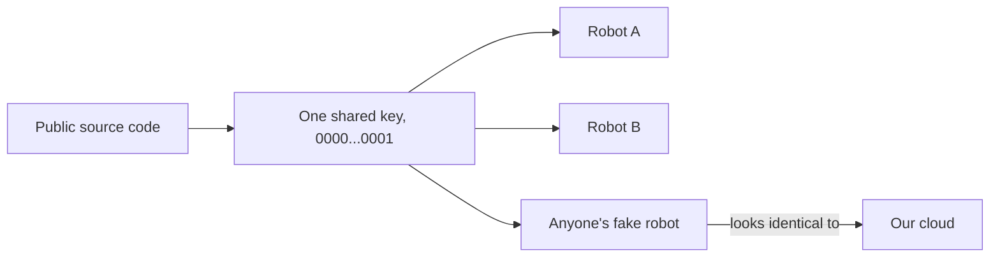
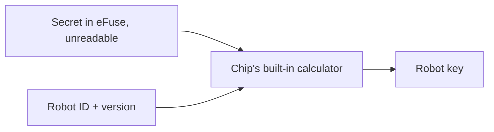
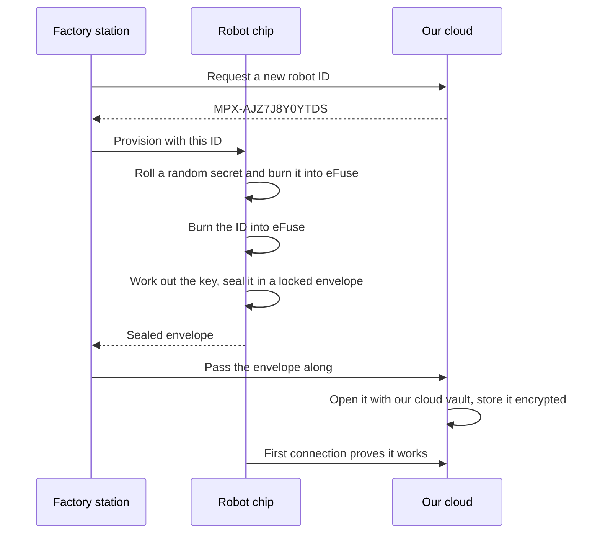
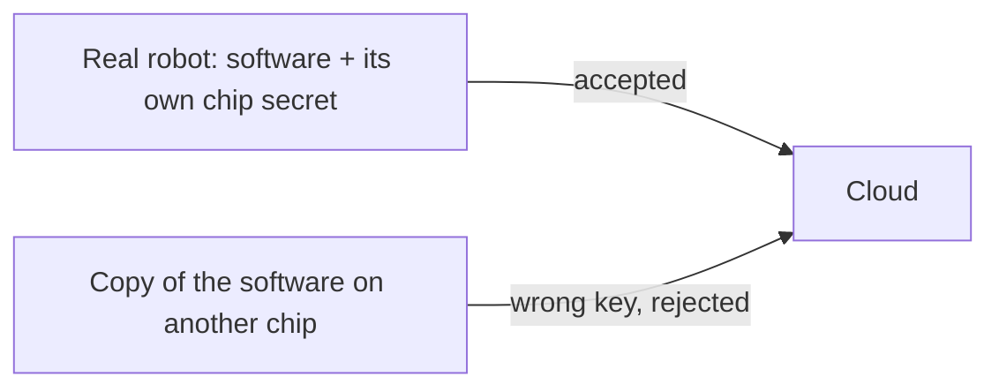
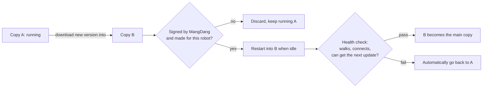

# Robot Identity in the Firmware: Why We're Building It

*A plain-language overview of how each robot gets a unique, unforgeable
identity, and how it gets software updates safely. Full technical design: `ROBOT_IDENTITY_AND_KEYS.md`. Cloud side:
`cloud/WHY_THIS_MATTERS.md`.*

**Status:** designed, mostly not built yet. The only firmware change so far is
that the robot now shows its token when it manages its own skills (see
section 8).

---

## Executive summary

- **Today every robot shares the same "password", and it's public.** It's in
  the source code, so anyone can pretend to be any robot.
- **Each robot will instead get its own secret, created inside its chip.**
  The secret is burned into the chip at the factory and can never be read out,
  not even by us.
- **The cloud gets what it needs without anyone seeing the secret.** The
  robot locks its key in an envelope that only our cloud can open.
- **Copying a robot's software to another robot doesn't copy its identity.**
  Purchases stay with the real robot.
- **Pilot robots for researchers use the same system first,** so nothing has
  to change once customers have robots.
- **Every MPX and MP4 robot must be updatable over the air (OTA), and today
  none can.** The robot's memory has room for only one copy of its software.
  Safe updates need room for two, and that doesn't fit in the current memory
  chip as things stand.
- **Some steps are one-way.** Burning a chip and laying out its memory can't
  be undone, so the decisions must be final before the first unit ships.

---

## 1. The problem today

Every robot is built with the same ID (`MPX-DOG-01`) and the same key, and both
are visible in our open-source code. Since purchases belong to a robot (there
are no customer accounts), **anyone could claim to be any robot and use its
purchases.**

**Rationale:** an identity that everyone knows isn't an identity.

## 2. Where the secret lives

The robot's chip (ESP32-S3) has a small area of **eFuses**: one-time
switches that are physically burned. Once burned, they can't be changed.

| Place to keep the secret | Survives reflashing? | Readable by an attacker? |
|---|---|---|
| In the firmware code | n/a | **Yes**: the code is public |
| In flash memory | No, a wipe erases it | **Yes**: flash can be copied |
| **In a read-protected eFuse** | **Yes**, permanently | **No**: the chip only lets software *use* it, never read it |

The firmware can ask the chip to *calculate with* the secret, which produces
the robot's key, but it can never see the secret itself.

**Rationale:** our firmware is open source, so the secret has to be protected
by hardware, not by hiding code.

## 3. How a robot gets its identity

This happens once, at the factory (or on an office bench for pilot units).

Key points:

- **The robot creates its own secret.** No person or computer ever holds it.
- **The factory station is only a courier.** It passes along a sealed envelope
  it can't open, so a compromised factory PC can't leak keys.
- **The cloud stores keys encrypted**, so a stolen database backup is useless.
- **The ID comes from the cloud**, which guarantees no two robots ever share one.

## 4. Why copying doesn't work

The software is the same for every robot, but the secret is different on
every chip. A copied robot calculates the wrong key and the cloud refuses it.

## 5. Locking down customer robots

Customer robots also get two standard chip features turned on:

- **Secure Boot:** the robot only runs firmware we've signed, so tampered
  firmware can't misuse the chip's secret.
- **Flash Encryption:** the robot's storage is unreadable if someone opens it
  up, which protects paid skills stored on it.

| | Pilot units (researchers, developers) | Kickstarter units |
|---|---|---|
| Unique chip identity | Yes | Yes |
| Permanent production ID | Yes | Yes |
| Secure Boot and Flash Encryption | Off, so developers can flash their own firmware | On |
| Can be upgraded later | Yes, back at the office | n/a |

**Rationale:** researchers need open robots; customers need protected ones.
Both use the **same** identity system, so pilot robots never need to be
re-registered and their purchases are never lost.

## 6. When things go wrong

| Situation | What happens |
|---|---|
| Robot's memory is wiped | Identity survives, because it's in the chip, not in memory |
| Main board dies | New board gets the **same robot ID** plus a fresh secret, so purchases carry over |
| Robot is stolen | We revoke it in the cloud; the owner's purchases stay on record |
| Power cut mid-setup | The station detects it and finishes the job |

## 7. Updating robots over the air

Once a robot leaves the office, an over-the-air (OTA) update is the only way
to fix bugs, close security holes, add features, or switch on the protections
above. Without OTA, every fix means a USB cable or a recall.

**Today's robots can't update themselves.** Their memory holds a single copy
of the software, so there's nowhere to put a new version while the old one
runs. The plan is to keep two copies, A and B:

| Safeguard | What it prevents |
|---|---|
| Two copies, A and B | A power cut mid-update bricking the robot |
| Automatic roll back after a failed health check | A bad release breaking the whole fleet |
| Only software signed by MangDang is accepted | Someone pushing malicious software, which could then misuse the chip's secret |
| An MPX robot refuses MP4 software, and vice versa | The wrong product's software driving the wrong motors |
| Old versions are refused | Someone reinstalling an old version that has a known hole |
| Installs only when idle and charged | A robot restarting mid-step or with a flat battery |
| Releases go to a few robots first, then everyone | A problem reaching every customer at once |

**The catch: memory space.** Two copies of today's software (7 MB each) don't
fit in the robot's 16 MB memory alongside everything else. The options are:

1. **Use a 32 MB memory chip** in MPX and MP4 production robots (recommended;
   a hardware decision).
2. **Slim down the software** so two copies fit.
3. **Shrink the space for customers' skills and files.**

**Rationale:** the memory layout is set when a robot first ships and can't be
changed by an update, so this must be settled before the first pilot robot
leaves.

## 8. What's done and what isn't

| Piece | Status |
|---|---|
| Design and decisions | Done (`ROBOT_IDENTITY_AND_KEYS.md`) |
| Robot shows its token when switching its own skills on or off | **Done** (`main/network/marketplace_proxy.cc`). Test robots need a reflash. |
| Reading the identity from eFuse (`main/identity/`) | To build |
| Factory/bench setup tool | To build |
| Cloud registry and key vault | To build |
| Secure Boot and Flash Encryption profile | To build and test |
| OTA updates (two copies, roll back, signed, product check) | Designed (`ROBOT_IDENTITY_AND_KEYS.md` D20); **blocked on the memory-size decision** |
| Cloud update service (who gets which version, when) | To build |

## 9. Why we have to decide now

Burning an eFuse is permanent, and so is a robot's memory layout. The pieces
that go into the chip (the ID format, how the key is worked out, how the
envelope is sealed), the memory layout that makes OTA possible, and the way
robots talk to the cloud must be **final before the first pilot unit ships**. Changing
them afterwards means supporting old robots forever, or recalling them.

**Rationale:** a few weeks of care now avoids a recall later.
